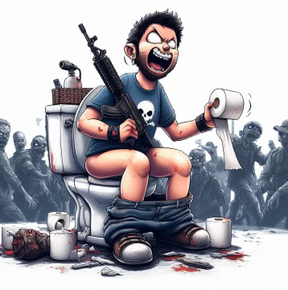

# TB Basic Needs

## Features
Full list of features can be found at [Shop](https://www.themodbase.com/mods/TBBasicNeeds)

## Shop Link
https://www.themodbase.com/mods/TBBasicNeeds

## Support

If you need any support, please open a ticket here: https://discord.gg/kGjN6gJy3m

## Youtube

- [Basic Needs](https://youtu.be/3CVjtuJO8gE)
- [Washing Machine](https://www.youtube.com/watch?v=Z5NNgfVLpaQ)

## Configurations

- [AdminConfig.json](../GlobalConfigs/AdminConfig.md) Permissions for config reloads and player reputation management.
- [BodyZoneConfigs.json](Configs/BodyZoneConfigs.md)
- [BodyZones.json](Configs/BodyZones.md)
- [Config.json](Configs/Config.md)
- [CurrencyConfig.json](../GlobalConfigs/Readme.md#currencyconfigjson)
- [DiseaseConfig.json](Configs/DiseaseConfig.md)
- [DryerConfig.json](Configs/DryerConfig.md)
- [ReputationConfig.json](Configs/ReputationConfig.md) Reputation rewards per gameplay action and admin menu setup.
- [StatcicDryerConfig.json](Configs/StaticDryerConfig.md)
- [StaticWashingPlaces.json](Configs/StaticWashingPlaces.md)
- [WashingMachineConfig.json](Configs/WashingMachineConfig.md)
## Reputation

Players can earn TBLib reputation by completing needs and washing actions and switching laundry machines on/off. Successful money deposits and withdrawals can also award configurable points. Rewards default to disabled. Server administrators can configure each reward in [ReputationConfig.json](Configs/ReputationConfig.md).

Administrators with `reputationAdmin` can open **[Admin] Manage player reputation** at washing machines and dryers to view and edit online and stored offline player totals. See the [setup instructions](Configs/ReputationConfig.md#manage-player-reputation).
