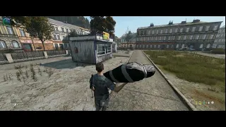
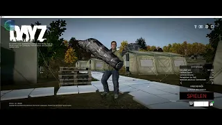

# TB Carry

## Features
Full list of features can be found at [Shop](https://www.themodbase.com/mods/TBCarry)

## Shop Link
https://www.themodbase.com/mods/TBCarry

## Support

If you need any support, please open a ticket here: https://discord.gg/kGjN6gJy3m

## Youtube

## How to install

See also [here](../The%20Mod%20Base/README.md)

- Take the Server PBO and bring it into your own server side pack
- Take the Client PBO and the TBLib PBO and bring it into your own client pack. Publish this pack on Steam.
- Start your server :-) 

## Configuration

[TBCarryGlobalConfig.md](TBCarryGlobalConfig.md)

### Item Class name
- TBCPlayerBaseBodyBag

### Optional compatibility add-ons

The compatibility add-ons are separate and must only be installed when the corresponding mod is used:

| Add-on | Required mod | Purpose |
|---|---|---|
| `TBDeathInsuranceAddon` | `TBDeathInsuranceServer` | Delays auto-packing until Death Insurance has finished processing and preserves items dropped by the insurance flow. |
| `TBRevivePlayerAddon` | `TBRevivePlayerServer` | Keeps the revive menu available until the player has made a death/revive decision, including players without insurance. |

Both add-ons also require the regular `TBCarryClient` and `TBCarryServer` PBOs. If both external mods are installed, both compatibility add-ons can be installed together.
