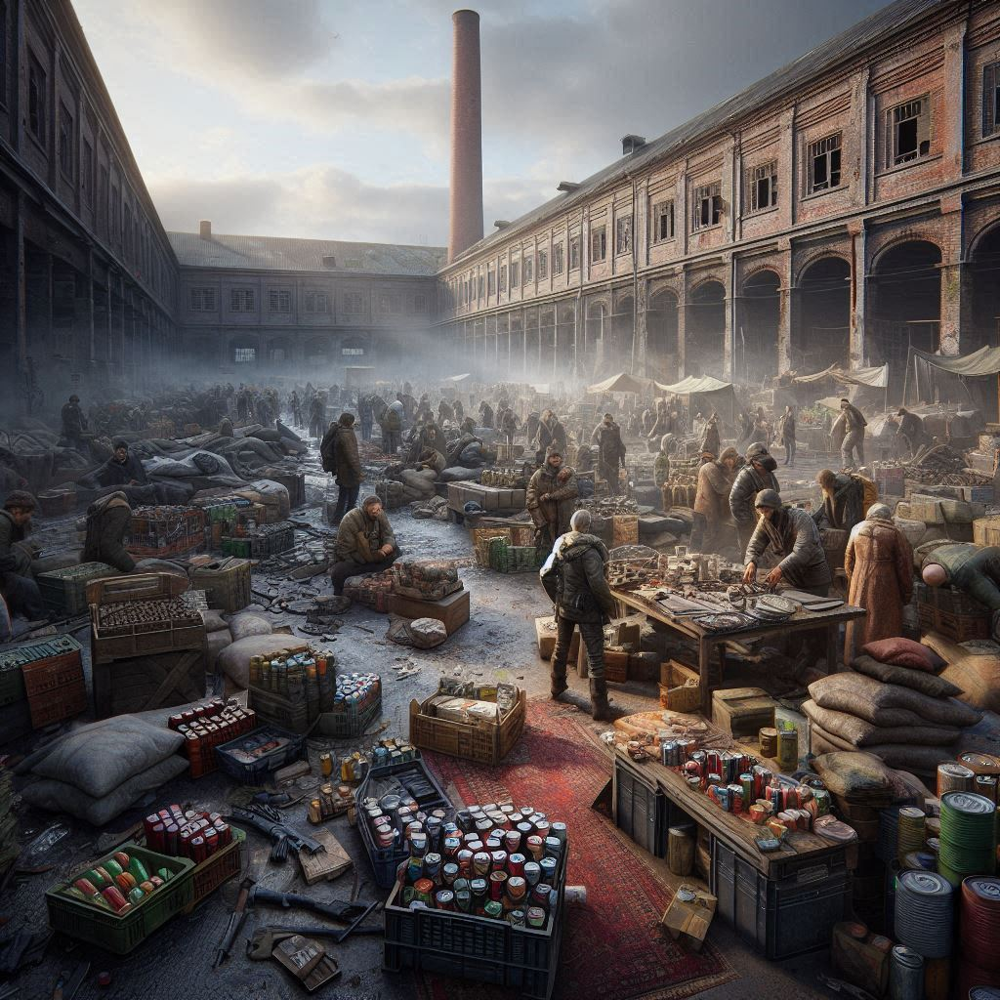

# TB Second Hand Market

## Features
Full list of features can be found at [Shop](https://www.themodbase.com/mods/TBSecondHandMarket)

## Shop Link
https://www.themodbase.com/mods/TBSecondHandMarket

## Support
If you need any support, please open a ticket here: https://discord.gg/kGjN6gJy3m

## Youtube
https://youtu.be/YXXO2QezOUU

## FAQ

### How to install
See also [here](../The%20Mod%20Base/README.md)

- Take the Server PBO and add it to your own server-side pack.
- Take the Client PBO and the TBLib PBO and add them to your own client pack. Publish this pack on Steam.
- Start the server and shut it down again once all configs are generated.
- Configure your needs.
- Start your server :-)

### How to give player premium status?
See [**`Global FAQ`**](../GlobalConfigs/Readme.md#FAQ)

### How to limit the condition (health level) of traded items?
Set it in [**`GeneralConfig.json`**](./Configs/GeneralConfig.md). Allowed values are `"Pristine"`, `"Worn"`, `"Damage"` and `"BadlyDamaged"`. The value is always the worst condition that is still allowed.
- `minOfferHealthValue`: worst condition an item may have to be offered for sale on a market stall or Global Stall. Default: `"BadlyDamaged"`. Items in a worse condition are not shown in the sell list, and the server rejects them. Ruined items can never be offered.
- `minOrderHealthValue`: worst condition players can choose when creating a buy order. Default: `"BadlyDamaged"`.

### How can admins moderate listings on the Bulletin Board?
Admins with the `secondHandMarket` permission can moderate all listings directly at the Bulletin Board:
- **View all items**: Toggle the "List all items" checkbox to reveal all listings, including disabled listings, unlisted personal stalls, and completed orders.
- **Delete listings**: Remove inappropriate offers or completed orders. Deleting completed orders frees up the reserved stall slots and permanently deletes associated storage files from the server.
- **Disable / Enable listings**: Temporarily deactivate specific listings on personal stalls or global stalls without deleting them (hidden from regular players).
- **Block player and delete/disable**: Block a player from trading and delete or disable their listing in one click.
- **Teleport to stall**: Click teleport in the item detail view to jump directly to the physical stall location.

### How do currencies work on market stalls?

Personal and global stalls use the currencies in the shared TBLib configuration. Add currencies to the `currencies` list in `CurrencyConfig.json` and keep one entry with `uniqueName` set to `default`. Existing listings and balances saved before multi-currency support load under `default`. [CurrencyConfig.json](../GlobalConfigs/CurrencyConfig.md)

- Select the currency next to the price fields when creating a purchase order. For a sale offer, select it above your inventory before clicking **Create** on the item.
- Buyers pay and sellers receive the currency shown on the listing. The Bulletin Board also shows that currency with the price.
- The header shows the player’s available balance by currency. The left panel in stall management shows the separate stall balances, including zero balances. Use **Manage** to select the currency for a deposit or withdrawal.
- Stall kit purchases use the currency configured for that dealer entry (`currencyType` in `StallConfigs.json`). If a stall's currency is not defined in `CurrencyConfig.json`, the buy button is disabled with "Price unavailable" and purchases are safely blocked server-side. Completed stall purchases also log the paid currency to CSV and Discord. Lifetime extensions, Bulletin Board publication fees and fixed global stall slot fees use `default`. [StallConfigs.json](./Configs/StallConfig.md)
- Percentage-based global stall listing fees and transaction taxes use the listing currency. [Global stall fees and taxes](./Configs/GlobalStallConfig.md#fee-and-tax-currencies)

### How do purchase orders and quantities work?
- Players can create buy orders with quantities up to 2000 units.
- The order form calculates the total in the selected currency. Personal stalls fund new orders from the available player balance in that currency, up to the order total. Global stalls require the additional funding shown in the form, including any configured order tax. Orders with insufficient stall funds in their own currency are hidden from other players.
- Completed orders (target quantity reached or zero remaining) display a clear "Purchased" badge in the Bulletin Board detail view so players know they are fulfilled.

## Types
- [**`Types`**](Types.md)

## Configs

- [**`AdminConfig.json`**](../GlobalConfigs/Readme.md#adminconfigjson)
- [**`BulletinBoard.json`**](./Configs/BulletinBoard.md)
- [**`CurrencyConfig.json`**](../GlobalConfigs/Readme.md#currencyconfigjson)
- [**`DealerPoints.json`**](./Configs/DealerPoints.md)
- [**`GeneralConfig.json`**](./Configs/GeneralConfig.md)
- [**`ItemWhiteList.json`**](./Configs/ItemWhiteList.md)
- [**`ItemBlackList.json`**](./Configs/ItemBlackList.md)
- [**`ItemPriceConfig.json`**](./Configs/ItemPriceConfig.md)
- [**`ItemsCategory.json`**](./Configs/ItemsCategory.md)
- [**`GlobalStallConfig.json`**](./Configs/GlobalStallConfig.md)
- [**`Logger.json`**](./Configs/Logger.md)
- [**`StallConfigs.json`**](./Configs/StallConfig.md)

