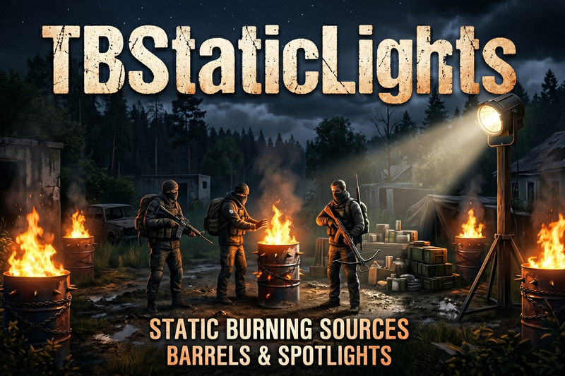

# TBStaticLights



### How to use.
- Place the Object with your Admin Tool.
- Go to the Object and open the Config Menu via F Action
- You can now set the height by just pressing once the rightmouse button to activate the move mode. The mouse move now changes the height. Once you are satisfied with the height press the rightmouse button again to deactivate it.
- You can now change the horizion by just press once the leftmouse button to activate move mode. The mouse move now changes the horizion. Once you are satisfied with the horizion press the leftmouse button again to deactivate it.
- In dropdown you can also change the type of the object.
** Dont forget to save it. Otherwise the object will not be available after server restart. **

### Types
- TBSLForeverAirfieldLamp
- TBSLForeverBurningBarrelBase
- TBSLForeverBurningBarrel_Green
- TBSLForeverBurningBarrel_Blue
- TBSLForeverBurningBarrel_Red
- TBSLForeverBurningBarrel_Yellow
- TBSLForeverFurnitureHangarLamp
- TBSLForeverFurnitureLuxuryLamp
- TBSLForeverHalogenLamp
- TBSLForeverLampHarbour
- TBSLForeverPowerPoleWood4Lamp
- TBSLForeverSpotlight
- TBSLForeverStadiumLamp

### Placeable Kits
As an alternative to the Admin Tool, a burning barrel can be placed with a kit item:
- Take the kit in your hands and switch to placing mode. A barrel hologram shows where it will be placed.
- Once placed, the kit turns into the matching Forever Burning Barrel and is removed.
- The barrel is saved to `LightObjects.json` automatically, so it is still there after a server restart. It can be edited via the Config Menu like any other object.
- **Only admins** with the Static Lights right can use the kits. If a player without this right places a kit, no barrel is created, an error message is shown and the kit stays in the player's hands.

| Kit | Placed object |
| --- | --- |
| TBSLBurningBarrelKit_Green | TBSLForeverBurningBarrel_Green |
| TBSLBurningBarrelKit_Blue | TBSLForeverBurningBarrel_Blue |
| TBSLBurningBarrelKit_Red | TBSLForeverBurningBarrel_Red |
| TBSLBurningBarrelKit_Yellow | TBSLForeverBurningBarrel_Yellow |

The kits do not spawn as loot by default. Spawn them with your Admin Tool or add them to your `types.xml`.


### Config

Path: `DayZServer\profiles\TBMods\Config\TBStaticLights\LightObjects.json`

```json line
{
    "adminObjects": [
        {
            "type": "TBSLForeverBurningBarrel_Blue", // type name
            "pos": [ // position X, Y, Z
                6540.8798828125,
                6.0229902267456059,
                2464.489990234375
            ],
            "rot": [ // rotation X, Y, Z
                9.9998197555542,
                0.0,
                -0.0
            ],
            "lightStates": [
                0
            ]
        },
        {
            "type": "TBSLForeverSpotlight", 
            "pos": [
                6540.31982421875,
                6.0229902267456059,
                2462.550048828125
            ],
            "rot": [
                215.0,
                0.0,
                -0.0
            ],
            "lightStates": [
                0
            ]
        },
        {
            "type": "TBSLForeverSpotlight",
            "pos": [
                6539.56005859375,
                6.0229902267456059,
                2461.909912109375
            ],
            "rot": [
                339.99798583984377,
                0.0,
                -0.0
            ],
            "lightStates": [
                0
            ]
        }
    ]
}
```